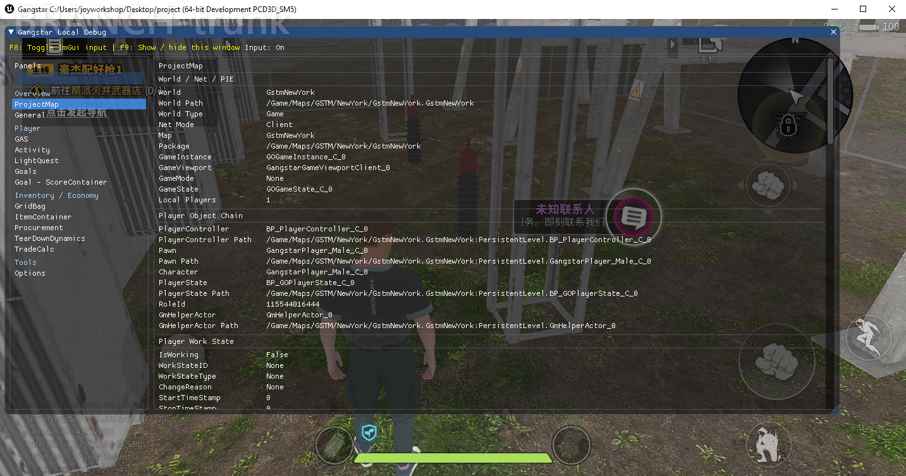
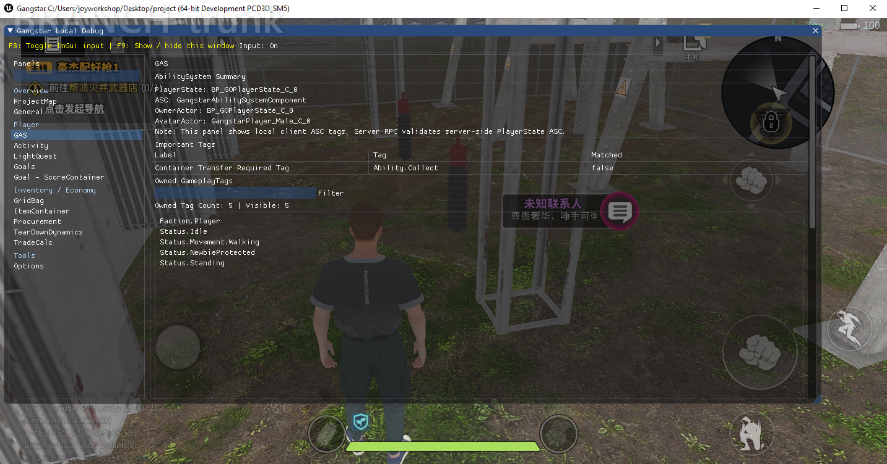
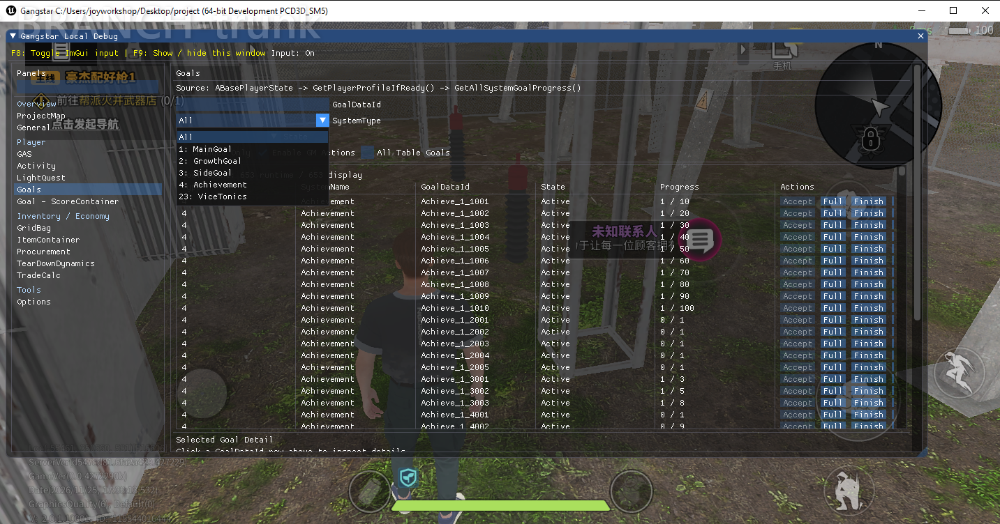
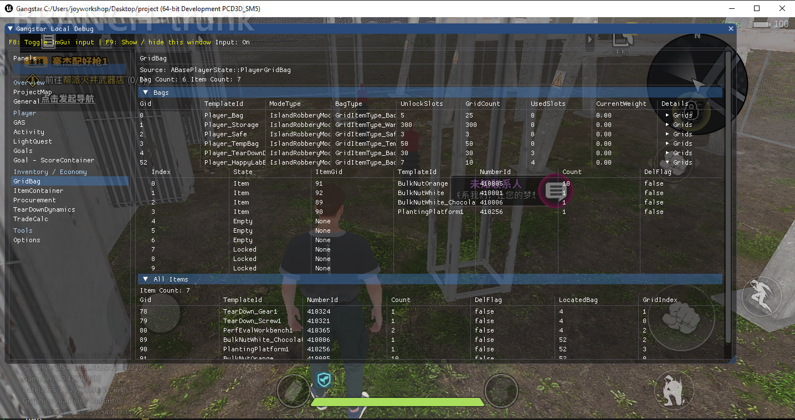

# xlsx-joyworkshop
gstm local imgui debugger








# GSTM Local ImGui Debugger

面向一个长期迭代的 UE 多人在线项目（UE4，Client / DS / GameServer 架构）的**本地运行时调试插件**。
以 Dear ImGui 为前端，把分散在服务端与各业务组件上的玩法状态集中暴露成运行时面板，支持直接查看与修改。

> 本仓库为个人记录用途，包含插件源码与运行截图。插件以本地形式使用，不进入项目主干、不随发布包分发。

## 为什么做这个

项目已迭代 4 年以上，模块规模很大，但缺少统一的运行时状态观测手段。
我负责的模块（物品容器、轻量任务、目标系统、采购订货、交易结算）状态全部由服务端持有，客户端只能看到同步后的结果。排查多端数据不一致时，原有流程是：

```
加日志 → 重新编译（常常 3000+ 文件）→ 重启 DS 与客户端 → 重走一遍玩法流程 → 看日志
```

一次循环成本很高，而偶现问题还不一定命中日志。曾有一个服务端接口偶现高频调用的问题，靠打日志反复复现了数天仍无结论。

结论是这个排查成本不合理，所以引入 ImGui 做了这个调试插件：**把要看的状态直接显示出来，并且能当场改**。

## 面板组织

面板按业务域分组，带名称过滤：

| 分组 | 面板 |
|------|------|
| Overview | ProjectMap、General |
| Player | GAS、Activity、LightQuest、Goals、Goal - ScoreContainer |
| Inventory / Economy | GridBag、ItemContainer、Procurement、TearDownDynamics、TradeCalc |
| Tools | Options |

快捷键分离设计：

- `F8` —— 切换输入捕获（ImGui 是否接管鼠标键盘）
- `F9` —— 切换窗口显示

两者分开是因为实际使用中经常需要「面板可见但输入仍给游戏」，或反之。

## 状态采集

每帧构建一次 `FGangstarLocalDebugContext`，把从 `UWorld` 出发需要层层获取的状态入口一次性解析完，再分发给各面板消费：

```
World / GameInstance / GameMode / GameState
PlayerController / Pawn / Character / PlayerState / GmHelperActor
AbilitySystemComponent
LightQuestComponent
ItemContainerManager
OwnerOnlyItemContainerReplicatorComponent     // 玩家侧容器复制
ViceTonicsProcurementComponent
CurrentHappyLabFactory
FactoryItemContainerReplicatorComponent       // 工厂侧容器复制
```

两点设计考虑：

- **集中解析**：面板不各自重复「从 World 挖到目标组件」这段链路，避免同一帧内重复查找与空指针判断分散到各处
- **前向声明**：Context 头文件只前向声明业务类型，不 include 业务头文件，避免调试插件把业务模块的头依赖扩散出去

## 工程隔离

调试代码不能进发布包，这里做了两层保障。

**模块依赖层**（`GangstarLocalDebug.Build.cs`）：

```csharp
bool bCanUseLocalImGui = Target.Configuration != UnrealTargetConfiguration.Shipping
    && Target.Configuration != UnrealTargetConfiguration.Test
    && Target.Type != TargetRules.TargetType.Server;
```

只有非 Shipping / 非 Test / 非 Server 配置才会添加 ImGui 及业务模块依赖，并定义 `WITH_GANGSTAR_LOCAL_IMGUI=1`。

**代码层**：模块实现与全部面板 include 都被 `#if WITH_GANGSTAR_LOCAL_IMGUI` 包住，宏为 0 时模块编译为空壳，仅保留 `IMPLEMENT_MODULE`。

**仓库层**：插件放在 `Plugins/Local/` 下并 gitignore，不进入项目主仓库。

这套隔离不是一开始就想到的——早期曾因 Shipping 宏使用不当导致打包失败，之后才改成由 `Build.cs` 在依赖层就切断，而不是只靠代码里的宏判断。

## 实际收益

- 容器、任务、目标进度这类状态从「加日志重编译」变成直接看
- 支持运行时修改状态，构造测试场景不再需要从头走玩法流程
- 新加的玩法模块（采购订货、交易结算、车辆改装）在开发期就同步补面板，自测效率明显提升
- 定位 DS 与客户端状态不一致问题时，可以同时看两侧的值，不再靠推断

## 关于实现方式

面板的 ImGui 绘制代码重复度很高，这部分大量借助 AI 加速产出。

由我决定的部分是：暴露哪些状态、面板如何按业务域组织、Context 的采集与分发结构、以及上面那套工程隔离方案。这些需要先理解项目里状态实际散落在哪些组件上——例如玩家容器与工厂容器走的是两套不同的复制组件，不清楚这点就做不出可用的面板。
